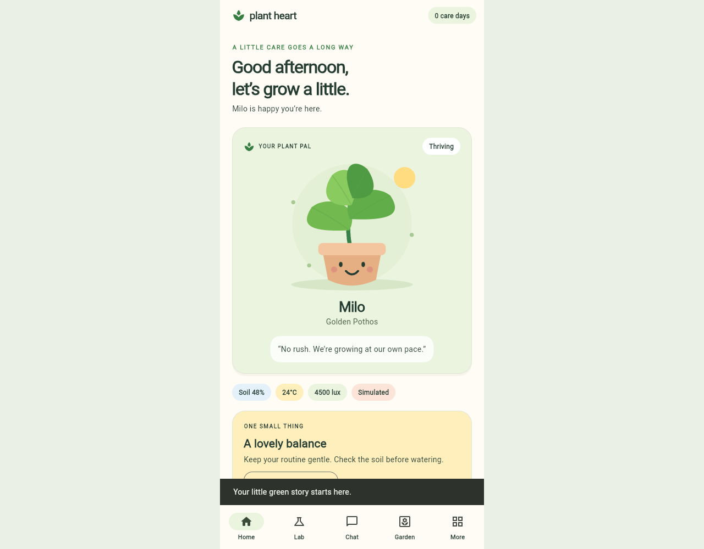

# Plant Heart

A friendly, offline Flutter plant companion for the AY 2026–2027 final-year
project. Meet **Milo**, explore simulated care conditions, keep memories and grow
a little routine. No hardware, keys, accounts, paid services or external AI needed.



## Run on Windows

1. Install **Flutter 3.47.8 / Dart 3.13.7** and Git; add Flutter's `bin` to PATH.
2. Install Visual Studio 2022 with **Desktop development with C++**, the Windows
   SDK and CMake tools. VS Code alone does not provide this native toolchain.
3. Extract/open the project root (the folder containing `pubspec.yaml`).
4. In PowerShell:

```powershell
flutter doctor -v
flutter config --enable-windows-desktop
flutter pub get --enforce-lockfile
flutter analyze
flutter test
flutter run -d windows
```

Or run `powershell -ExecutionPolicy Bypass -File .\scripts\run-windows.ps1`.
The helper only runs dependency resolution and launch; no admin rights required.
For a release executable use `flutter build windows`. Ship the entire resulting
`build\windows\x64\runner\Release` folder, not just the exe. Windows platform
files are included, with a 540×960 starting window and a centered 480px app.
The UI also adapts to narrower screens. Android and iOS runners are future work.

Internet is needed for SDK/dependency installation. Normal installed-app use is
offline. There is no backend to start and no `.env` or secret configuration.

## What's inside

- **First run:** plant name, species and personality; optional defaults; locally saved.
- **Home:** original animated Milo, reactive expressions, care tip, sensors,
  navigation shortcuts, earned daily care checks and recent activity.
- **Lab:** five bounded sensor sliders, four presets, saved snapshots and recent
  moisture bars with expandable reading details.
- **Chat:** deterministic profile/sensor-aware responses, explicit `Remember that …`
  capture, latest-memory recall, suggested prompts, keyboard send and persistent chat.
- **Garden:** memory and journey views; add/edit/confirmed delete, timestamps,
  lifecycle selection, activity timeline and copyable journey summary.
- **More:** care recommendations, simulated weather/location, local community
  posts/likes/visits and an earned three-day challenge, three plant-library profiles,
  settings, accessibility and deliberate local data clearing/reset.

All UI is English. Care and emotion rules are illustrative; this app does not
measure real plant emotions or provide validated horticultural or medical advice.

## Architecture and storage

`lib/main.dart` handles boot; `lib/app/` owns the shell and shared controller;
`lib/models/` owns typed data and serialization; `lib/services/` owns care/emotion,
sensor/weather rules, local agent and storage; `lib/features/` owns screens;
`lib/widgets/` owns the design system and vector character.

One `ChangeNotifier` controls shared state. Sensor or species changes feed all
care, mood and chat views. Shared preferences stores a version-1 JSON document
(`plant_heart_v1`) on this device. Writes are ordered, failures are visible and
retryable, and unreadable originals are preserved in recovery copies before
showing defaults. Storage is **unencrypted**, local-only and not cloud backed up.
Do not enter sensitive information. Uninstalling/clearing browser data can remove
records. A summary copied to the clipboard is not a full backup/import format.

See [architecture and rules](docs/ARCHITECTURE.md), [initial audit](docs/AUDIT.md),
[feature matrix](docs/FEATURE_MATRIX.md), [proposal traceability](docs/TRACEABILITY.md)
and [validation report](docs/VALIDATION.md).

## Validate

```powershell
flutter pub get --enforce-lockfile
flutter analyze
flutter test
flutter build windows
```

`scripts/verify.ps1` runs these commands and preserves failures. The Linux cloud
host can run analysis/tests and `flutter build web --release --no-web-resources-cdn`.
The built web version bundles renderer assets locally; serve `build/web` from a
static server. This does not claim an installable offline PWA: opening the web
app still needs access to its static host. The native Windows app requires no
network during operation.

## Boundaries

Sensors, weather and community are explicitly local simulations. Chat is a small
rule engine, memory recall is latest-entry lookup, and safety handling is only a
prototype keyword demonstration. Check-ins use the device calendar, not a server.
Sharing is an inert, clearly labelled future preference. Check-in reminders are
an in-app card, not operating-system notifications. Emotions recalculate on UI
updates; no background emotion scheduler or proactive dialogue is implemented.

Future scope: physical pot/firmware, BLE/device connection, battery/power, live
weather, cloud profiles, authenticated family sharing, encryption, LLM/RAG/vector
memory, voice/TTS, camera/photos, time-lapse/memorial video and native mobile builds.
Photo checkpoints currently use honest text milestones. Windows native execution
must still be verified on Windows; it cannot run on this Linux cloud host.


Windows follow-up: a user confirmed native launch, but reported repeated Flutter
AXTree accessibility errors during interaction. The latest change reduces global
semantics rebuilds and passes 20 tests; Windows confirmation is still pending.
See the follow-up in `docs/VALIDATION.md`. Do not treat Linux/widget success as
proof of native Windows accessibility correctness.


## New local preview: Pixel Display Studio

Open **More → Pixel Display Studio → Open display window** for a separate pixel
face window. Preview eight expressions, follow Lab/Weather, cycle scenes, switch to
monochrome, or open the comparison sheet. Manual previews never change plant data.
The logical artwork is 32×32 pixels and respects reduce-motion preferences.
See [pixel display details](docs/PIXEL_DISPLAY.md).

The second native window uses a temporary loopback-only connection (127.0.0.1);
the browser popup uses same-origin local storage. No external service is required.
This is a software screen simulator; no physical display driver is implemented.
Close all Plant Heart windows before rebuilding on Windows. Windows native launch
of the second process still requires testing on a Windows machine.

## Home reading overview

Home now stacks all five environmental readings in the center of the page. Each
has a value/unit, five labelled status bands, a pointer and an Ideal range derived
from the active species. The scale displays five care zones rather than a linear
number line. Info buttons explain numeric boundaries; **Change readings in Lab**
opens the existing controls. See [Home status-bar rules](docs/HOME_GAUGES.md).
