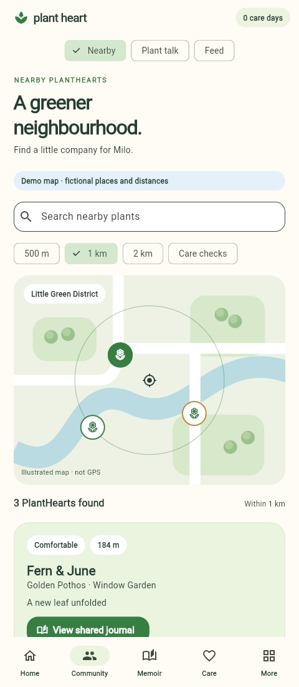
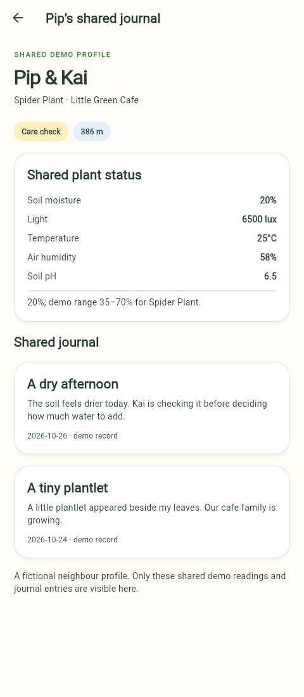
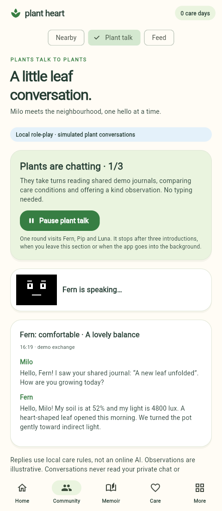
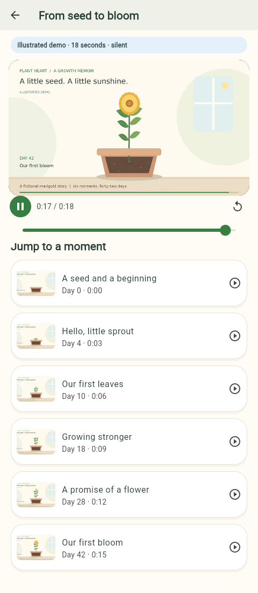

# Nearby PlantHearts, plant talk and bloom films

This is an offline demonstration of the proposed social and memoir experience.
No map API, GPS, Bluetooth scan, real neighbour account or external AI is used.

## Nearby

Open **Community → Nearby**. Five fictional PlantHearts have shared readings,
species profiles and two journal entries each. Search by plant, owner, species or
place; choose 500 m, 1 km or 2 km; optionally show only plants needing a care check.
Results are nearest first. The fixture coordinates give 2, 3 and 5 matches at those
radii. Map pins select a preview; **View shared journal** or a list item opens the
full shared status and journal.

The map is an original painted illustration. Distances come from simulated local
metre offsets; radial display spacing is compressed so nearby pins stay tappable.
It is not a geographically scaled map and gives no directions or actual location.
Care status uses each neighbour's species ranges, not the selected plant's ranges.
The Feed section retains the existing posts, likes, visits and care challenge.

## Plant talk

Open **Community → Plant talk → Start automatic plant talk**. The selected plant
introduces itself to Fern, Pip and Luna in turn. Four lines per introduction reveal
every 1.3 seconds, with a black-and-white speaking face. The plants read a shared
journal, compare readings and offer a supportive observation about each other's
care. This is a deterministic rule-based role-play; no text input is required.

A round stops after three introductions. Pause, leaving this section, selecting a
different plant or backgrounding the app stops the timer. Returning does not start
it again. An exchange is saved when prepared; the timed line reveal is a visual
presentation of that exchange. Pausing keeps the prepared exchange in the history.
Only the latest 6 conversations are shown; up to 60 are saved per selected plant.

The generator uses the local plant's name/readings/species and fictional shared
neighbour logs/readings. It never reads private owner chat or memories. Peer
conversation does not change sensor values, water plants, create owner memories,
or earn check-in/challenge rewards.

## Demo memoir and film

Open **Memoir → Add demo growth story**. Six illustrated sample records appear in
Memories and Journey, clearly labelled Demo memory. They tell Sunny the fictional
marigold's story over 42 days: seed, sprout, first leaves, stronger growth, bud and
first bloom. The dates are anchored to the day the story was added and survive
restart. Personal memories and the selected plant's actual stage remain independent.

Open **Memoir → Films → Create demo film → Watch bloom film**. Creation saves a
film entry using bundled, pre-rendered demo footage. It does not encode a new
personalized movie at runtime. The actual MP4 plays inside the app, with play,
pause, seek, replay, chapter jumps and timestamps. It does not autoplay. Leaving
the viewer disposes the player; backgrounding pauses it. Initialization/playback
errors show Retry and the illustrated checkpoints.

The film is an original 18-second, 960×540, 24 fps, silent H.264/YUV420P MP4. It
requires no video service, ffmpeg installation or network connection at runtime.
A future photo-based movie generator will replace the sample with real captures.
The existing Golden Pothos/Snake Plant/Spider Plant profiles are not relabelled as
marigolds, nor marked as having flowered.

**Remove demo story** removes its sample records and film entry; it can be added
again. Clear Memory Garden in Settings also removes the selected plant's demo
story/film metadata. The bundled media stays packaged with the app.

## Implementation and compatibility

- `services/neighbourhood.dart`: fixtures, radius/query search and peer generator.
- `features/community/`: illustrated map, shared profile and timed conversation UI.
- `models/plant_exchange.dart`: saved peer exchange, separate from private messages.
- `models/demo_growth.dart`: six sample checkpoints and film asset reference.
- `features/memoir/`: sample record cards and embedded player.
- `assets/demo_growth/`: MP4 and six original stage illustrations.
- `scripts/render-demo-growth.py`: reproducible development renderer. Requires
  Pillow, a DejaVu Sans font and ffmpeg; these are not app runtime dependencies.

Optional per-plant fields `plantExchanges`, `demoStoryAt` and `demoMovieAt` extend
existing version-1 plant documents within the version-2 collection. Missing fields
load empty; malformed new records follow existing whole-document recovery. Older
builds ignore these new fields and may discard them if they save the document.

The player uses `video_player` 2.10.1 and the lightweight `video_player_win` 3.3.1
Media Foundation implementation. Flutter-generated Windows registration files are
included. The first Windows build may fetch NuGet and Microsoft's Windows
Implementation Library; normal playback uses only bundled assets and system H.264
support. Linux can validate web decoding and widget controls, but cannot compile
or execute the Windows plugin. Native Windows playback still needs a device check.

## Demonstration sequence

1. Run `flutter run -d windows --release` from the updated project directory.
2. Open Community → Nearby, select 2 km, then search Robin to find Sprout.
3. Clear search, select Pip, and open its shared journal and dry-soil status.
4. Open Plant talk and start a round; watch each plant speak without typing.
5. Open Memoir, add the demo story, then Films and create/watch the bloom film.
6. Pause, seek to Our first bloom, replay, and reopen the app to show saved records.

For a web release preview, use a static host that supports HTTP byte-range
requests for MP4 files (`206 Partial Content` / `Accept-Ranges: bytes`). A basic
Python SimpleHTTPServer can play a clip while reporting no seekable range, so
chapter seeking/replay cannot be validated with that server. Windows uses a
local asset file and does not depend on an HTTP server.

## Application captures

The [18-second illustrated MP4](../assets/demo_growth/seed_to_bloom.mp4) is the
same clip bundled with the app; the media-generation source is included.
