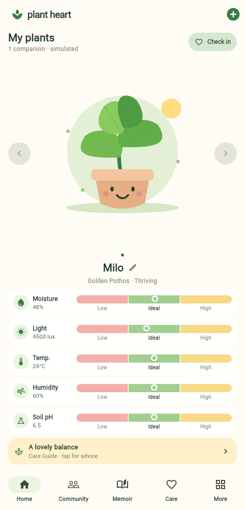
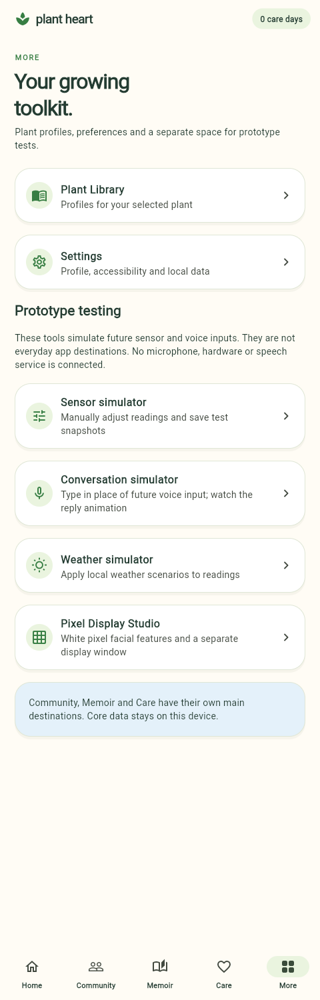
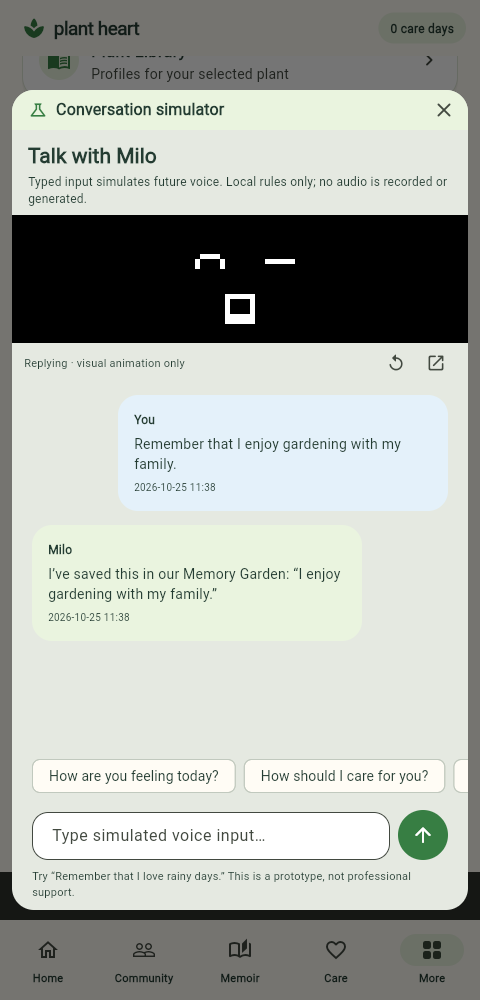
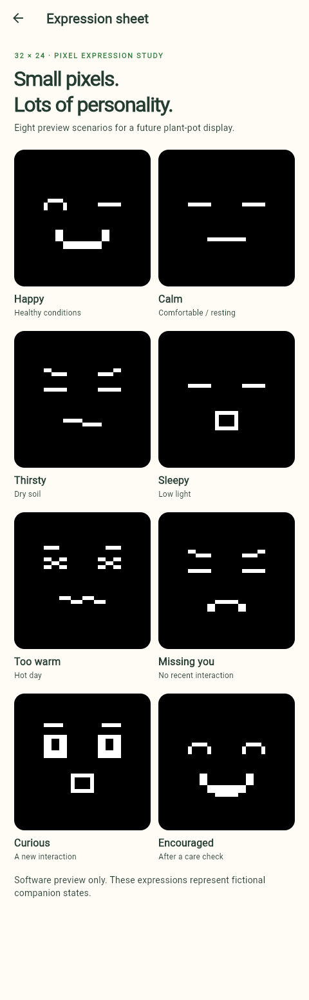

# Product navigation and prototype tools

The main bar has five everyday destinations:

| Destination | Purpose |
| --- | --- |
| Home | Selected plant, arrow switching, readings, status and care check-in |
| Community | Local posts, likes, visits and care challenge |
| Memoir | Saved memories and growth journey |
| Care | Species-aware care recommendations |
| More | Plant library, settings and a separate prototype-testing area |

Community is still an offline simulation, not a connected social service.
Memories and conversations remain independent for each selected plant.

## Testing through More

Each entry opens an in-app dialog with a Close test window button. Closing a tool
returns to More without losing plant data. The selected plant is shared with Home.

| Tool | Demo action |
| --- | --- |
| Sensor simulator | Adjust five readings, choose a preset, save a snapshot |
| Conversation simulator | Type in place of future voice input, send, watch the reply, replay its animation |
| Weather simulator | Preview/apply a local weather scenario |
| Pixel Display Studio | Compare eight black-and-white expressions, follow readings or manually cycle scenes |

For a tutor demonstration, open the independent display from the studio, close
the tool popup, then open Sensor simulator and choose Dry Soil. Home, Care and the
display should agree on the dry condition. Open Conversation simulator and send a
message: the inline face and separate display animate together. Use Replay reply
animation to demonstrate again without adding messages. `Remember that I like
gardening` also creates an explicit memory visible in Memoir.

The separate face is an actual additional browser window/native process; the
other tools are dialogs inside the main application. A browser may open the face
in a tab or block it until popups are allowed. The face has no head silhouette,
colored fill or avatar ring. No microphone or generated audio is involved.

## Hide test entries

Testing is visible by default for this prototype. For an everyday UI demonstration:

```powershell
flutter run -d windows --dart-define=PLANT_HEART_TEST_TOOLS=false
```

For a release build use the same define with `flutter build windows`. Without it,
the test entries remain available. This switch hides entry points; it does not
connect sensors, implement voice recognition, or add a social backend. The full
widget suite exercises the default prototype; the flag-specific check is:

```powershell
flutter test test/product_navigation_test.dart --dart-define=PLANT_HEART_TEST_TOOLS=false
```

## Actual application previews

These captures are stored with the source so GitHub can render them directly.






