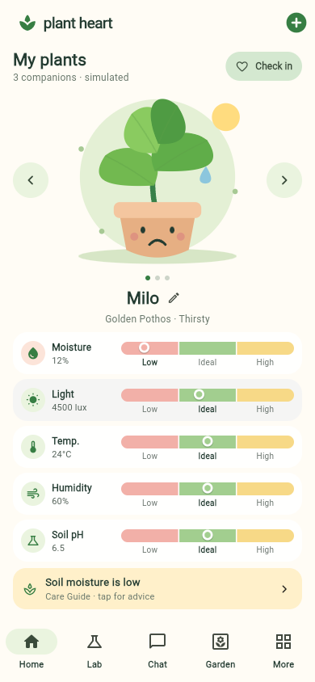
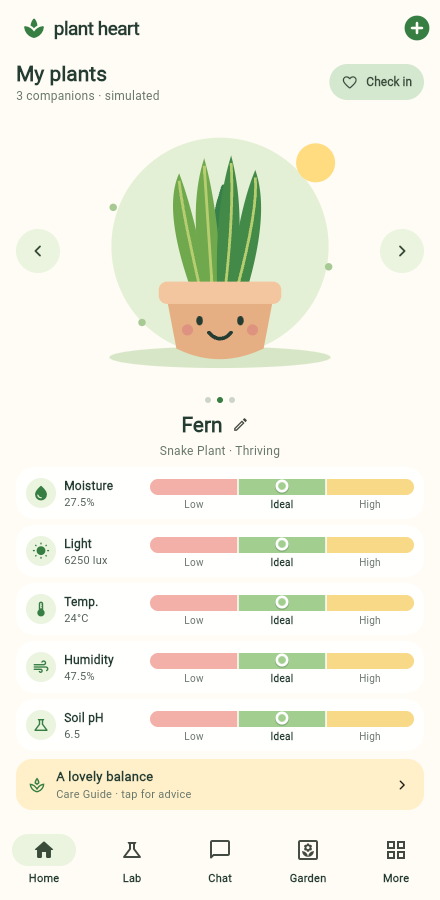
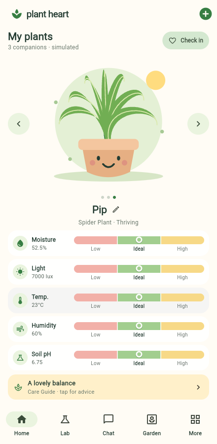
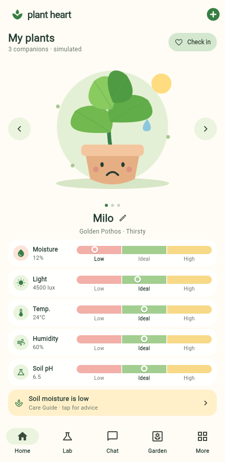

# Compact Home previews

Open this page on GitHub while signed in to an account with repository access.
These are actual Flutter application screenshots, rather than interface mockups.

## Mobile overview

All five readings, plant selection and care entry are visible without scrolling
at the default text size. Milo is selected and has a simulated dry-soil reading.

## Snake Plant

## Spider Plant

## Golden Pothos

Use the plus button to add a plant. Left/right arrows select independent plant
records. The screenshots illustrate sample local plants; existing user plants
are preserved rather than replaced with these examples.
